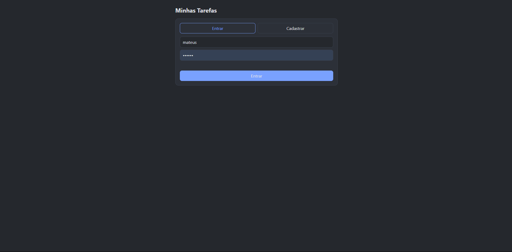
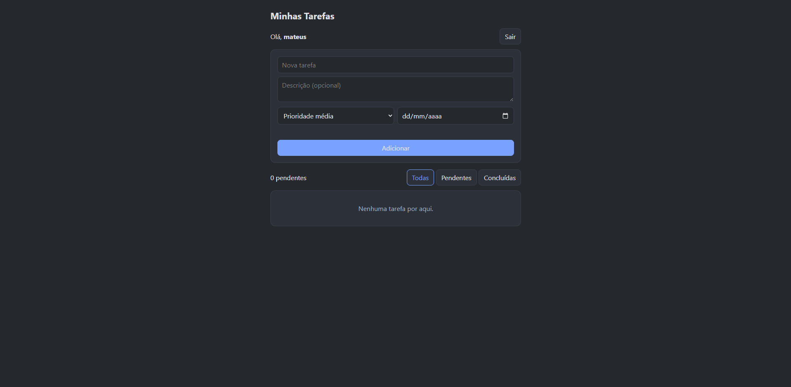

# To-Do List — API REST + Tela Web

Aplicação de lista de tarefas com **login de usuários**, **API REST em Java (Spring Boot)** e uma
**tela web** servida pelo próprio servidor. Cada usuário cria, edita, conclui e exclui as suas
tarefas, e **só enxerga as próprias**.

## O que o projeto faz

1. O usuário se cadastra e faz login pela tela.
2. A API devolve um token JWT, que a tela envia em todas as requisições seguintes.
3. As tarefas ficam salvas em PostgreSQL, ligadas ao usuário dono.
4. A tela permite organizar as tarefas por prioridade e data limite e filtrar por status.

O mesmo projeto também inclui o CRUD de produtos com controle por papéis (ADMIN e USER),
que serviu de base para a autenticação.

## Funcionalidades

### Tela
- Cadastro e login
- Adicionar, editar e excluir tarefas
- Marcar como concluída (e desmarcar)
- Prioridade: baixa, média ou alta
- Data limite opcional (tarefas atrasadas ficam em vermelho)
- Filtros: todas, pendentes e concluídas, com contador de pendentes
- Tema claro e escuro automático, de acordo com o sistema
- Mensagens de erro claras (campos inválidos, sessão expirada, servidor fora do ar)

### API
- Autenticação com JWT (válido por 2 horas) e senhas com BCrypt
- Tarefas isoladas por usuário
- Validação dos dados com mensagens por campo
- Respostas padronizadas de erro (400, 401, 403, 404)
- Lista ordenada: pendentes primeiro, depois as mais recentes

## Tecnologias

| Tecnologia | Uso |
|---|---|
| Java 26 | Linguagem |
| Spring Boot 4 | Framework base |
| Spring Web MVC | Controllers REST e arquivos estáticos |
| Spring Data JPA | Persistência e repositórios |
| PostgreSQL | Banco de dados |
| Spring Security + java-jwt | Autenticação e autorização |
| Spring Validation | Validação dos dados de entrada |
| Lombok | Redução de código repetitivo |
| Maven Wrapper | Build |
| HTML, CSS e JavaScript puros | Tela (sem frameworks, sem build) |

## Como funciona a segurança

1. No login, nome e senha são validados (BCrypt) e a API devolve um token JWT.
2. A tela guarda o token no `localStorage` e o envia no header `Authorization: Bearer <token>`.
3. Um filtro (`SecurityFilter`) valida o token a cada requisição e identifica o usuário.
4. As consultas de tarefas sempre filtram pelo usuário logado: a tarefa de outra pessoa
   responde **404**, sem revelar que ela existe.
5. Token ausente, inválido ou expirado resulta em **401**, e a tela volta para o login.
6. A aplicação é stateless (sem sessão no servidor).

A página em si (`index.html`) é pública, mas ela não contém dados: tudo que importa
vem da API e exige login.

## Endpoints

### Autenticação (públicos)

| Método | Rota | Descrição |
|---|---|---|
| POST | `/api/v1/auth/register` | Cadastra usuário (sempre com papel `User`) |
| POST | `/api/v1/auth/login` | Autentica e devolve o token |

```json
// POST /api/v1/auth/register
{ "nome": "mateus", "senha": "123456", "email": "mateus@email.com" }

// POST /api/v1/auth/login
{ "nome": "mateus", "senha": "123456" }
// resposta: { "token": "eyJhbGciOi..." }
```

### Tarefas (exigem token)

| Método | Rota | Descrição | Resposta |
|---|---|---|---|
| GET | `/api/v1/tasks` | Lista as tarefas do usuário logado | `200` |
| POST | `/api/v1/tasks` | Cria uma tarefa | `201` + tarefa |
| PUT | `/api/v1/tasks/{id}` | Edita uma tarefa | `200` / `404` |
| PATCH | `/api/v1/tasks/{id}/toggle` | Alterna entre pendente e concluída | `200` / `404` |
| DELETE | `/api/v1/tasks/{id}` | Exclui uma tarefa | `204` / `404` |

```json
// POST ou PUT /api/v1/tasks
{
  "titulo": "Estudar Spring Security",
  "descricao": "Revisar filtros e JWT",
  "prioridade": "ALTA",
  "dataLimite": "2026-11-20"
}
```

| Campo | Regra |
|---|---|
| `titulo` | obrigatório, até 100 caracteres |
| `descricao` | opcional, até 500 caracteres |
| `prioridade` | `BAIXA`, `MEDIA` ou `ALTA` (padrão: `MEDIA`) |
| `dataLimite` | opcional, formato `AAAA-MM-DD` |

Resposta de uma tarefa:
```json
{
  "id": "uuid",
  "titulo": "Estudar Spring Security",
  "descricao": "Revisar filtros e JWT",
  "concluida": false,
  "prioridade": "ALTA",
  "dataCriacao": "2026-11-12T10:30:00",
  "dataLimite": "2026-11-20"
}
```

Dados inválidos retornam `400`:
```json
{ "erro": "Dados invalidos", "campos": { "titulo": "O titulo e obrigatorio" } }
```

### Produtos (exigem token)

| Método | Rota | Acesso |
|---|---|---|
| GET | `/api/v1/products` e `/api/v1/products/{id}` | USER ou ADMIN |
| POST, PUT, DELETE | `/api/v1/products` | somente ADMIN |

## Configuração

Os segredos **não ficam no código**. Eles são lidos de variáveis de ambiente ou de um arquivo
`local.properties` na raiz do projeto (ao lado do `pom.xml`), que **não deve ser versionado**.

| Variável | Obrigatória | Descrição |
|---|---|---|
| `DB_PASSWORD` | Sim | Senha do PostgreSQL |
| `JWT_SECRET` | Sim | Chave de assinatura do token (32+ caracteres aleatórios) |
| `ADMIN_NOME` | Não | Nome do ADMIN criado na inicialização |
| `ADMIN_EMAIL` | Não | E-mail do ADMIN |
| `ADMIN_SENHA` | Não | Senha do ADMIN |

Exemplo de `local.properties`:
```properties
DB_PASSWORD=sua_senha_do_postgres
JWT_SECRET=uma-chave-longa-e-aleatoria-com-32-ou-mais-caracteres
ADMIN_NOME=admin
ADMIN_EMAIL=admin@email.com
ADMIN_SENHA=senha-do-admin
```

Adicione `local.properties` ao `.gitignore`. Para gerar uma chave aleatória (PowerShell):
```powershell
[Convert]::ToBase64String((1..48 | ForEach-Object { Get-Random -Maximum 256 }) -as [byte[]])
```

## Como executar

### Pré-requisitos
- JDK 26
- PostgreSQL em execução

### Passos

1. Clone o repositório:
   ```bash
   git clone https://github.com/mateuspacheco436/To-do-list.git
   cd To-do-list
   ```
2. Crie o banco de dados:
   ```sql
   CREATE DATABASE todolist;
   ```
3. Crie o `local.properties` com os valores da seção anterior.
4. Execute:
   ```bash
   ./mvnw spring-boot:run        # Linux/Mac
   mvnw.cmd spring-boot:run      # Windows
   ```
   Ou, no IntelliJ, rode a classe `ListApplication` pelo botão verde.
5. Abra **http://localhost:8082** no navegador.

A tabela `tarefas` (e as demais) é criada automaticamente na primeira execução.

> **Atenção:** acesse sempre pelo endereço do servidor (`localhost:8082`). Abrir o
> `index.html` pela pré-visualização do IntelliJ (porta 63342) mostra a tela, mas a API não
> existe ali e o login não funciona.

## Como usar

1. Clique em **Cadastrar**, informe nome, e-mail e senha (mínimo 6 caracteres).
2. Adicione tarefas com título, descrição, prioridade e data limite.
3. Marque a caixa para concluir, use **Editar** ou **Excluir**, e filtre pela parte superior da lista.
4. Para conferir o isolamento, crie um segundo usuário em uma janela anônima: ele não vê as
   tarefas do primeiro.

## Testando a API (Insomnia ou Postman)

1. `POST http://localhost:8082/api/v1/auth/login` e copie o `token` da resposta.
2. Nas demais requisições, use a aba **Auth > Bearer Token** com esse token.
3. Exemplo: `GET http://localhost:8082/api/v1/tasks`.

## Estrutura do projeto

```
src/main
├── java/com/example/crud
│   ├── Controller
│   │   ├── AuthenticaionController.java   # login e cadastro
│   │   ├── TaskController.java            # CRUD de tarefas
│   │   └── ProductsController.java        # CRUD de produtos
│   ├── Domain
│   │   ├── Tasks     # Task, TaskPriority, RequestTask, TaskResponse
│   │   ├── User      # Usuario, UserRoles, DTOs de autenticação
│   │   └── Products  # Products, RequestProduct, RequestUpdateProduct
│   ├── Infra
│   │   ├── Exception # RestExceptionHandler (erros padronizados)
│   │   └── Security  # SecurityConfigurations, SecurityFilter, TokenService, AdminInitializer
│   ├── Repository    # TaskRepository, UserRepository, ProductsRepository
│   └── Services      # AutorizationServices
└── resources
    ├── application.properties
    └── static
        └── index.html                     # tela da aplicação
```
## Imagem do projeto
# To-Do List — API REST + Tela Web

Aplicação de lista de tarefas com **login de usuários**, **API REST em Java (Spring Boot)** e uma
**tela web** servida pelo próprio servidor. Cada usuário cria, edita, conclui e exclui as suas
tarefas, e **só enxerga as próprias**.

## O que o projeto faz

1. O usuário se cadastra e faz login pela tela.
2. A API devolve um token JWT, que a tela envia em todas as requisições seguintes.
3. As tarefas ficam salvas em PostgreSQL, ligadas ao usuário dono.
4. A tela permite organizar as tarefas por prioridade e data limite e filtrar por status.

O mesmo projeto também inclui o CRUD de produtos com controle por papéis (ADMIN e USER),
que serviu de base para a autenticação.

## Funcionalidades

### Tela
- Cadastro e login
- Adicionar, editar e excluir tarefas
- Marcar como concluída (e desmarcar)
- Prioridade: baixa, média ou alta
- Data limite opcional (tarefas atrasadas ficam em vermelho)
- Filtros: todas, pendentes e concluídas, com contador de pendentes
- Tema claro e escuro automático, de acordo com o sistema
- Mensagens de erro claras (campos inválidos, sessão expirada, servidor fora do ar)

### API
- Autenticação com JWT (válido por 2 horas) e senhas com BCrypt
- Tarefas isoladas por usuário
- Validação dos dados com mensagens por campo
- Respostas padronizadas de erro (400, 401, 403, 404)
- Lista ordenada: pendentes primeiro, depois as mais recentes

## Tecnologias

| Tecnologia | Uso |
|---|---|
| Java 26 | Linguagem |
| Spring Boot 4 | Framework base |
| Spring Web MVC | Controllers REST e arquivos estáticos |
| Spring Data JPA | Persistência e repositórios |
| PostgreSQL | Banco de dados |
| Spring Security + java-jwt | Autenticação e autorização |
| Spring Validation | Validação dos dados de entrada |
| Lombok | Redução de código repetitivo |
| Maven Wrapper | Build |
| HTML, CSS e JavaScript puros | Tela (sem frameworks, sem build) |

## Como funciona a segurança

1. No login, nome e senha são validados (BCrypt) e a API devolve um token JWT.
2. A tela guarda o token no `localStorage` e o envia no header `Authorization: Bearer <token>`.
3. Um filtro (`SecurityFilter`) valida o token a cada requisição e identifica o usuário.
4. As consultas de tarefas sempre filtram pelo usuário logado: a tarefa de outra pessoa
   responde **404**, sem revelar que ela existe.
5. Token ausente, inválido ou expirado resulta em **401**, e a tela volta para o login.
6. A aplicação é stateless (sem sessão no servidor).

A página em si (`index.html`) é pública, mas ela não contém dados: tudo que importa
vem da API e exige login.

## Endpoints

### Autenticação (públicos)

| Método | Rota | Descrição |
|---|---|---|
| POST | `/api/v1/auth/register` | Cadastra usuário (sempre com papel `User`) |
| POST | `/api/v1/auth/login` | Autentica e devolve o token |

```json
// POST /api/v1/auth/register
{ "nome": "mateus", "senha": "123456", "email": "mateus@email.com" }

// POST /api/v1/auth/login
{ "nome": "mateus", "senha": "123456" }
// resposta: { "token": "eyJhbGciOi..." }
```

### Tarefas (exigem token)

| Método | Rota | Descrição | Resposta |
|---|---|---|---|
| GET | `/api/v1/tasks` | Lista as tarefas do usuário logado | `200` |
| POST | `/api/v1/tasks` | Cria uma tarefa | `201` + tarefa |
| PUT | `/api/v1/tasks/{id}` | Edita uma tarefa | `200` / `404` |
| PATCH | `/api/v1/tasks/{id}/toggle` | Alterna entre pendente e concluída | `200` / `404` |
| DELETE | `/api/v1/tasks/{id}` | Exclui uma tarefa | `204` / `404` |

```json
// POST ou PUT /api/v1/tasks
{
  "titulo": "Estudar Spring Security",
  "descricao": "Revisar filtros e JWT",
  "prioridade": "ALTA",
  "dataLimite": "2026-11-20"
}
```

| Campo | Regra |
|---|---|
| `titulo` | obrigatório, até 100 caracteres |
| `descricao` | opcional, até 500 caracteres |
| `prioridade` | `BAIXA`, `MEDIA` ou `ALTA` (padrão: `MEDIA`) |
| `dataLimite` | opcional, formato `AAAA-MM-DD` |

Resposta de uma tarefa:
```json
{
  "id": "uuid",
  "titulo": "Estudar Spring Security",
  "descricao": "Revisar filtros e JWT",
  "concluida": false,
  "prioridade": "ALTA",
  "dataCriacao": "2026-11-12T10:30:00",
  "dataLimite": "2026-11-20"
}
```

Dados inválidos retornam `400`:
```json
{ "erro": "Dados invalidos", "campos": { "titulo": "O titulo e obrigatorio" } }
```

### Produtos (exigem token)

| Método | Rota | Acesso |
|---|---|---|
| GET | `/api/v1/products` e `/api/v1/products/{id}` | USER ou ADMIN |
| POST, PUT, DELETE | `/api/v1/products` | somente ADMIN |

## Configuração

Os segredos **não ficam no código**. Eles são lidos de variáveis de ambiente ou de um arquivo
`local.properties` na raiz do projeto (ao lado do `pom.xml`), que **não deve ser versionado**.

| Variável | Obrigatória | Descrição |
|---|---|---|
| `DB_PASSWORD` | Sim | Senha do PostgreSQL |
| `JWT_SECRET` | Sim | Chave de assinatura do token (32+ caracteres aleatórios) |
| `ADMIN_NOME` | Não | Nome do ADMIN criado na inicialização |
| `ADMIN_EMAIL` | Não | E-mail do ADMIN |
| `ADMIN_SENHA` | Não | Senha do ADMIN |

Exemplo de `local.properties`:
```properties
DB_PASSWORD=sua_senha_do_postgres
JWT_SECRET=uma-chave-longa-e-aleatoria-com-32-ou-mais-caracteres
ADMIN_NOME=admin
ADMIN_EMAIL=admin@email.com
ADMIN_SENHA=senha-do-admin
```

Adicione `local.properties` ao `.gitignore`. Para gerar uma chave aleatória (PowerShell):
```powershell
[Convert]::ToBase64String((1..48 | ForEach-Object { Get-Random -Maximum 256 }) -as [byte[]])
```

## Como executar

### Pré-requisitos
- JDK 26
- PostgreSQL em execução

### Passos

1. Clone o repositório:
   ```bash
   git clone https://github.com/mateuspacheco436/SEU-REPOSITORIO.git
   cd SEU-REPOSITORIO
   ```
2. Crie o banco de dados:
   ```sql
   CREATE DATABASE crud;
   ```
3. Crie o `local.properties` com os valores da seção anterior.
4. Execute:
   ```bash
   ./mvnw spring-boot:run        # Linux/Mac
   mvnw.cmd spring-boot:run      # Windows
   ```
   Ou, no IntelliJ, rode a classe `ListApplication` pelo botão verde.
5. Abra **http://localhost:8082** no navegador.

A tabela `tarefas` (e as demais) é criada automaticamente na primeira execução.

> **Atenção:** acesse sempre pelo endereço do servidor (`localhost:8082`). Abrir o
> `index.html` pela pré-visualização do IntelliJ (porta 63342) mostra a tela, mas a API não
> existe ali e o login não funciona.

## Como usar

1. Clique em **Cadastrar**, informe nome, e-mail e senha (mínimo 6 caracteres).
2. Adicione tarefas com título, descrição, prioridade e data limite.
3. Marque a caixa para concluir, use **Editar** ou **Excluir**, e filtre pela parte superior da lista.
4. Para conferir o isolamento, crie um segundo usuário em uma janela anônima: ele não vê as
   tarefas do primeiro.

## Testando a API (Insomnia ou Postman)

1. `POST http://localhost:8082/api/v1/auth/login` e copie o `token` da resposta.
2. Nas demais requisições, use a aba **Auth > Bearer Token** com esse token.
3. Exemplo: `GET http://localhost:8082/api/v1/tasks`.

## Estrutura do projeto

```
src/main
├── java/com/example/crud
│   ├── Controller
│   │   ├── AuthenticaionController.java   # login e cadastro
│   │   ├── TaskController.java            # CRUD de tarefas
│   │   └── ProductsController.java        # CRUD de produtos
│   ├── Domain
│   │   ├── Tasks     # Task, TaskPriority, RequestTask, TaskResponse
│   │   ├── User      # Usuario, UserRoles, DTOs de autenticação
│   │   └── Products  # Products, RequestProduct, RequestUpdateProduct
│   ├── Infra
│   │   ├── Exception # RestExceptionHandler (erros padronizados)
│   │   └── Security  # SecurityConfigurations, SecurityFilter, TokenService, AdminInitializer
│   ├── Repository    # TaskRepository, UserRepository, ProductsRepository
│   └── Services      # AutorizationServices
└── resources
    ├── application.properties
    └── static
        └── index.html                     # tela da aplicação
```
## Imagem do projeto



## Possíveis melhorias

- Paginação e busca por texto na lista de tarefas
- Categorias ou etiquetas
- Migrations do Flyway em vez de `ddl-auto=update`
- Testes automatizados (unitários e de integração)
- Documentação interativa com Swagger/OpenAPI
- Publicação (deploy) com endereço público

## Autor

Mateus Pacheco — [@mateuspacheco436](https://github.com/mateuspacheco436)

## Possíveis melhorias

- Paginação e busca por texto na lista de tarefas
- Categorias ou etiquetas
- Migrations do Flyway em vez de `ddl-auto=update`
- Testes automatizados (unitários e de integração)
- Documentação interativa com Swagger/OpenAPI
- Publicação (deploy) com endereço público

## Autor

Mateus Pacheco — [@mateuspacheco436](https://github.com/mateuspacheco436)